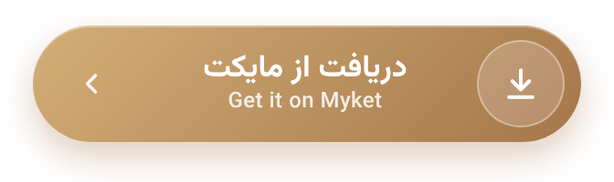
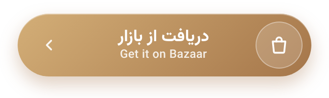
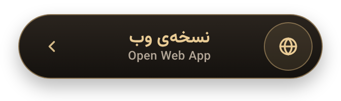
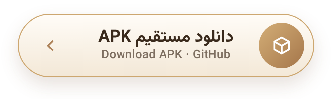

# کهربا | Kahroba

**دفتر دیجیتال تعمیرکاران لوازم برقی** — رایگان، متن‌باز (غیرتجاری)، بدون تبلیغ و کاملاً آفلاین.

بخاری، سماور، لباسشویی، کولر یا هر وسیله‌ای که به مغازه می‌آید، در چند ثانیه یک پرونده‌ی کددار می‌گیرد
و هر وقت لازم شد سابقه‌اش جلوی چشمتان است. همه‌ی اطلاعات فقط روی گوشی خودتان می‌ماند.

## دریافت

   
   
   
  

## امکانات

- **پرونده‌ها:** ثبت سریع، کد پرونده و کد ثابت دستگاه، وضعیت از پذیرش تا تحویل، قطعات و اجرت، گارانتی، عکس قبل و بعد
- **امضای مشتری** هنگام پذیرش و تحویل، روی رسید
- **پیامک:** رسید پذیرش، اعلام هزینه و آماده‌ی تحویل با یک لمس
- **مشتری و دستگاه:** سابقه‌ی کامل و برچسب QR
- **داشبورد:** کارهای در جریان، آماده‌ی تحویل و هشدار وسایل جامانده
- **مالی:** طلب از مشتری‌ها، گزارش ماهانه و نرخ‌نامه
- **تقویم کارهای در محل** با اعلان یادآور
- **بانک فنی:** کدهای خطا و راهنمای عیب‌یابی بر اساس علامت خرابی
- **قفل برنامه**، **پشتیبان‌گیری** و **همگام‌سازی با همکار** از طریق Wi‑Fi
- تم روشن، تیره و مشکی؛ فارسی، راست‌به‌چپ و تاریخ شمسی؛ مناسب گوشی و تبلت

## مشارکت در بانک فنی

پیشنهاد کد خطا یا راهنمای عیب‌یابی تازه با Pull Request روی فایل `assets/kb/kb.json` خوش‌آمد است.
لطفاً از سرویس‌منوال‌ها کپی نکنید و با بیان خودتان بنویسید.

## مجوز

کد کهربا **متن‌باز با مجوز غیرتجاری** است (جزئیات در فایل [`LICENSE`](LICENSE)):

- استفاده از برنامه برای همه آزاد و رایگان است، حتی در کسب‌وکار.
- برداشتن کد برای برنامه‌ی دیگر، انتشار نسخه‌ی تغییریافته و هر نوع تجاری‌سازی بدون اجازه‌ی کتبی ممنوع است.
- محتوای بانک فنی: CC BY-NC-SA 4.0
- فونت وزیرمتن: صابر راستی‌کردار، SIL Open Font License

---

طراحی و ساخت: **Alion**
