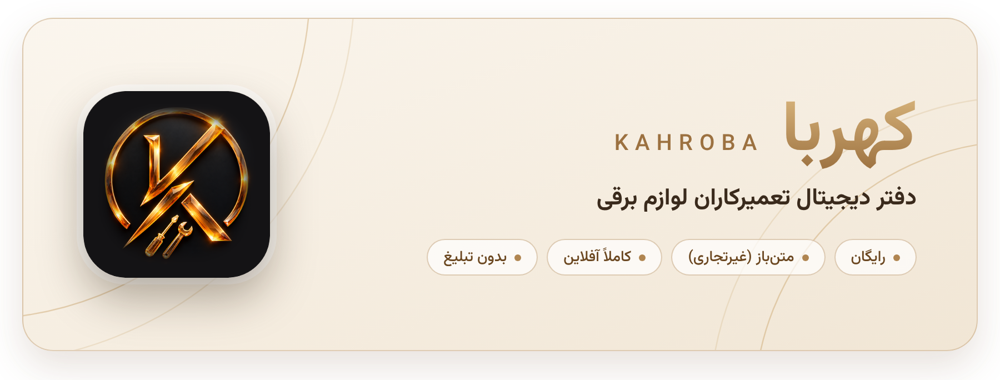
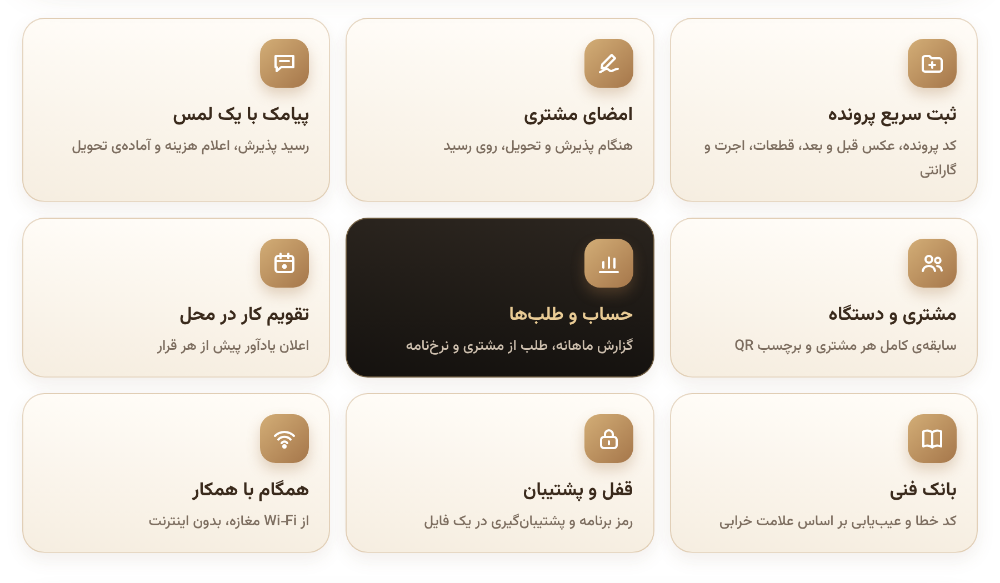
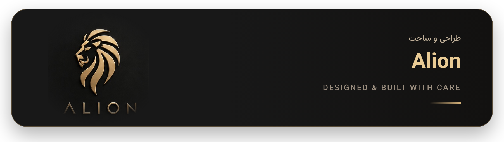

  

  بخاری، سماور، لباسشویی، کولر یا هر وسیله‌ای که به مغازه می‌آید، در چند ثانیه یک پرونده‌ی کددار می‌گیرد 
  و هر وقت لازم شد سابقه‌اش جلوی چشمتان است. همه‌ی اطلاعات فقط روی گوشی خودتان می‌ماند.

<h2 align="center">دریافت</h2>

   
   
   
  

<h2 align="center">امکانات</h2>

  

  تم روشن، تیره و مشکی · فارسی، راست‌به‌چپ و تاریخ شمسی · مناسب گوشی، تبلت و مرورگر

<h2 align="center">مشارکت در بانک فنی</h2>

  پیشنهاد کد خطا یا راهنمای عیب‌یابی تازه با Pull Request روی فایل <code>assets/kb/kb.json</code> خوش‌آمد است. 
  لطفاً از سرویس‌منوال‌ها کپی نکنید و با بیان خودتان بنویسید.

<h2 align="center">مجوز</h2>

  کد کهربا <b>متن‌باز با مجوز غیرتجاری</b> است (جزئیات در فایل <a href="LICENSE"><code>LICENSE</code></a>). 
  استفاده از برنامه برای همه آزاد و رایگان است، حتی در کسب‌وکار. 
  برداشتن کد برای برنامه‌ی دیگر، انتشار نسخه‌ی تغییریافته و هر نوع تجاری‌سازی بدون اجازه‌ی کتبی ممنوع است. 
  محتوای بانک فنی: CC BY-NC-SA 4.0 · فونت وزیرمتن: صابر راستی‌کردار، SIL Open Font License

 

  

